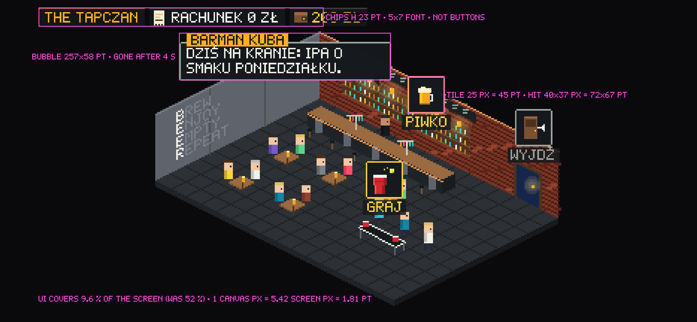
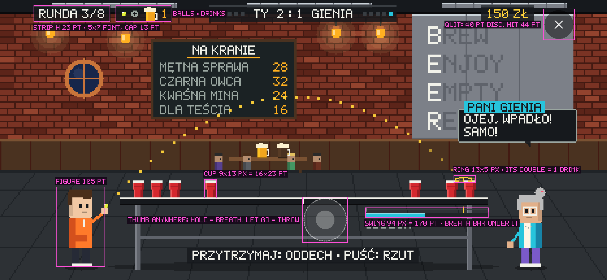
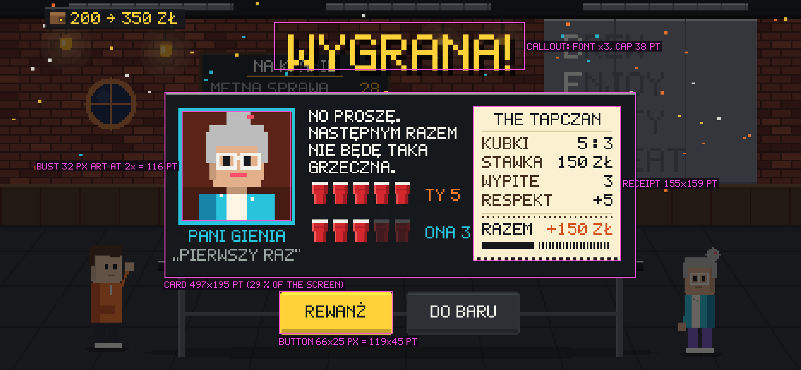
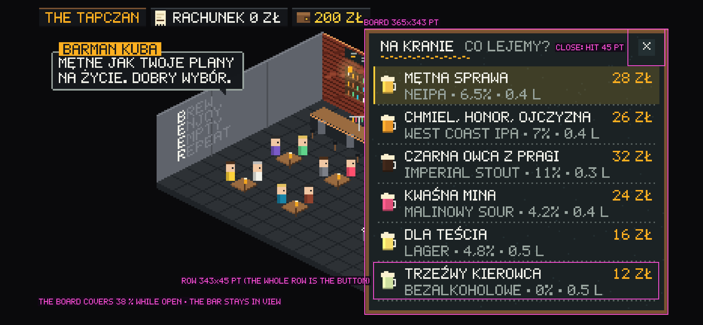
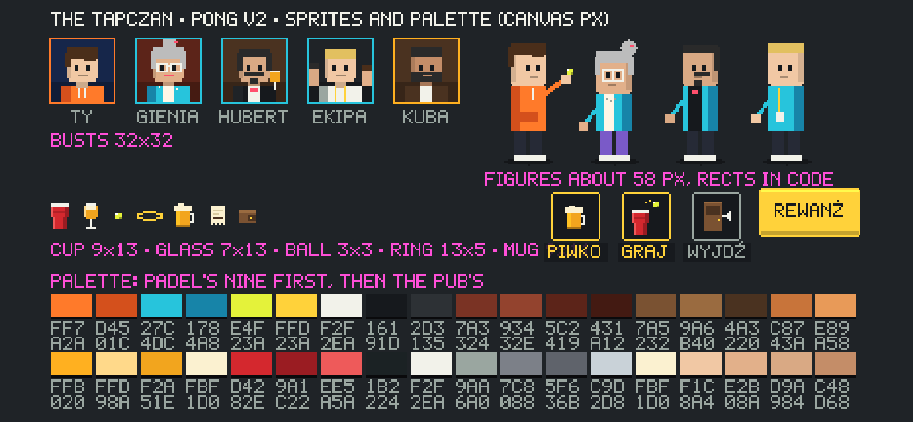

# THE TAPCZAN, inside UI and beer pong v2: "Rzut na raz" (design brief, 2026-11-25)

F, after the phone: the interface inside the Tapczan is huge and the game looks like junk; invent
the look and the mechanic from scratch. Style: **pixel art, like the padel match**. This is the
concept for F and the coordinator. No game code yet; section 5 is the build plan for the next pass.

**Second pass, the same day: `tapczan-pong-v2-physics-and-fun.md`** is the critique of this brief's
mechanic and the improved design (real ball physics, a lung per turn, the bounce shot, tells, the
dare, heat, juice). Where the two differ, the addendum wins: this brief's 3.1 to 3.6, its sim
constants and API (5.1 step 3), its check (5.3) and its PHONE-CHECK rows (5.5) are superseded.
Sections 1, 2, 3.7, 3.8, 4 and the rest of 5 (the look, the room UI, the tap list, the wiring,
performance) stand.

Files next to this one:

| File | What |
| --- | --- |
| `tapczan-pong-v2-mock-1-room.png` | the room with the new slim UI |
| `tapczan-pong-v2-mock-1b-taps.png` | the tap list as a chalkboard |
| `tapczan-pong-v2-mock-2-aim.png` | beer pong, the aim moment |
| `tapczan-pong-v2-mock-3-result.png` | the win and the payout |
| `tapczan-pong-v2-mock-4-sprites.png` | sprites and palette |
| `tapczan-pong-v2-mocks.py` | draws the five PNGs (`python3 -I`, standard library, the game's own 5x7 font) |
| `tapczan-pong-v2-sim.py` | the first pass's balance prototype (the table in 3.6); superseded |
| `tapczan-pong-v2-physics-and-fun.md` | **the second pass: critique, physics, fun, the numbers that are built, the build plan** |
| `tapczan-pong-v2-physics-sim.py` | the reference 60 Hz sim `pong_sim.gd` is ported from, with the bots and tables |

All mocks are 2532x1170 at padel's pixel scale. Pink lines and words are size notes, not UI
(`--plain` renders without them). In mocks 1 and 1b the room is a flat stand-in for the game's
existing 3D cutaway, which stays as it is.

## 1. What is wrong now

Measured on F's iPhone screenshot (2868x1320; the same at 2532x1170 in brackets):

| Element | Size on screen | Share of the screen |
| --- | --- | --- |
| Title card, "THE TAPCZAN · W ŚRODKU" and the bill line | 1411x371 px (1246x328) | 14 % |
| Barman's line card | 2157x357 px (1904x315) | 20 % |
| Three buttons, each | 720x310 px (636x274), 240x103 pt | 18 % together |
| **All of it** | | **52 %** |

- **Everything is drawn at twice its intended size.** `tapczan_room.gd` asks for 120x52 pt
  buttons and a 17 pt title; the screenshot shows 240x103 pt and a 34 pt title, and the 16 pt
  margin is 32 pt. The room's `CanvasLayer` is a child of the room, which lives under `world`
  inside the city's SubViewport (`main.gd` `_join(Tapczan.new(), world, ...)`). That viewport is
  rendered at half size on the phone (`view.stretch_shrink` 2) and stretched, while `hud.pt` is
  the full screen's 3 px a point. So the UI is doubled and soft. Padel is a child of `main` (the
  root viewport), which is why it is sharp. This was read from the code and the 2.0x measure, not
  yet confirmed by a run; the build pass confirms it first (5.1).
- Even at the intended size it is the wrong kind of UI: three text buttons, a title that says
  where you already are, a dialogue card detached from the person speaking.
- **The pong.** A fake 3D perspective table drawn with anti-aliased polygons and the system
  font: neither the city's look nor padel's. Red discs for cups, a letter for the rival, no room
  around it. The slingshot has one skill (pull length) and the rival's turn is dead time.
- **Balance was one number** per rival (`skill`), and "balls back" let a rival run the table in
  one turn (PT-56).

## 2. The new look

**Style: padel's pixel art.** The same 216-row canvas (467 px wide on a 19.5:9 phone), shown
nearest-filtered over the whole screen; flat rects, no outlines, a two-tone shade on every body,
soft light only as 2-3 stacked translucent discs (the lamps). The 5x7 `PixelFont` for every
word. One canvas px is 5.42 screen px, or **1.81 pt**, at 2532x1170.

Why pixel art and not a poster look: F asked for it, padel already proves it on the phone, and
it needs no textures: one canvas item, rects from code.

### 2.1 Palette

Padel's nine, unchanged (you are orange, the rival is cyan, as in padel):

| Name | Hex | Use here |
| --- | --- | --- |
| US / US_DARK | `#ff7a2a` / `#d4501c` | your hoodie, your score pips, the payout figure |
| THEM / THEM_DARK | `#27c4dc` / `#1784a8` | the rival's top, pips, name tab, the breath bar |
| BALL | `#e4f23a` | the ball |
| GOLD | `#ffd23a` | the aim ring and arc, primary edges and buttons, money |
| LINE | `#f2f2ea` | text, cup rims, the table's edge, chalk |
| FRAME | `#16191d` | the table top, strips, cards, the soffit |
| COURT | `#2d3135` | the slate floor |

The pub's, new:

| Name | Hex | Use |
| --- | --- | --- |
| brick, light, dark, mortar | `#7a3324` `#93432e` `#5c2419` `#431a12` | the wall |
| wood, light, dark | `#7a5232` `#9a6b40` `#4a3220` | wainscot, frames, tables (padel's scoreboard wood) |
| copper, light | `#c8743a` `#e89a58` | the bar's edge, lamp caps, the porthole |
| amber, glow | `#ffb020` `#ffd98a` | lamps, prices, the barman's name tab (`UiKit.HEAT`) |
| beer, foam | `#f2a51e` `#fbf1d0` | glasses, the receipt paper |
| cup, dark, light | `#d4282e` `#9a1c22` `#ee5a5a` | the red cups |
| board, dust, chalk dim | `#1b2224` `#243033` `#9aa6a0` | the chalkboard, second lines |
| slate light, dark | `#383d42` `#1f2327` | floor joints, strip edges |
| concrete, dark, chrome | `#7c8088` `#5f636b` `#c9d2d8` | the BREW ENJOY wall, table legs, ducts |
| skins | `#f1c8a4` `#e2b08a` `#d9a984` `#c48d68` | padel's four |

### 2.2 The pong screen (mock 2)

Seen **from the side**, like padel's court: you on the left, the rival on the right, the black
table between, the pub's brick wall behind (the chalk tap list, the porthole, amber lamps, the
concrete with BREW ENJOY EMPTY REPEAT, four regulars at a back table who cheer like padel's
crowd).

| Thing | Canvas px | Points | Notes |
| --- | --- | --- | --- |
| Figure (you, rival) | about 20x58 | 36x105 | padel's chibi built larger: head 18, body 23, legs 16; rects in code |
| Table | 283 long, top 6 thick, at row 152 | 511 | black, a 1 px white edge, a centre tick |
| Cup | 9x13 | 16x23 | red, white rim 2 px, dark right side; five a side, 14 px apart |
| Hubert's tasting glass | 7x13, mouth 5 | 13x23 | amber, a stem and a foot |
| Ball | 3x3 | 5 | padel's ball; a 2 px fading trail |
| Aim ring | 13x5 | 23x9 | a gold ellipse on the cups' mouths; a faint double appears with drinks |
| Arc | 2x2 dots | | gold, from the hand to the ring |
| Swing track and breath bar | 94 long, 3 high | 170 | under the table's lip, below the rival's cups |
| Top strips | 13 high | 23 | padel's black strip, a 1 px edge: round, balls and drinks, the score with five pips a side, the stake |
| Speech bubble | up to 150 wide, 10 a line | 271 | dark card, 1 px chalk edge, the name on a coloured tab, a tail to the speaker |
| Quit | 40 pt disc | hit 44 | padel's own, drawn at the screen's resolution |

No aim hand or reticle graphics beyond the ring and arc: the figure's arm swings with the ring,
which is what tells you the rhythm.

### 2.3 Portraits

32x32 busts on a dark tile with a 1 px ring (cyan for a rival, orange for you, amber for the
barman). Shown at 1x on the rival card (58 pt) and at 2x on the result (116 pt). Mock 4 has all
five: you, Pani Gienia (grey bun, white glasses, pearls), Pan Hubert (moustache, goatee, bow
tie, the tasting glass he never puts down), the crew (three heads, lanyards), Barman Kuba
(beard, apron).

### 2.4 The room (mock 1)

The 3D room stays. Over it, drawn in the same pixel unit and at the root viewport:

| Element | Canvas px | Points | Behaviour |
| --- | --- | --- | --- |
| Top-left chips: THE TAPCZAN, RACHUNEK n ZŁ, wallet | 13 high, 191 wide together | 23 high | not buttons; the bill chip flashes gold for 0.4 s when it grows |
| Barman's (anyone's) line | bubble 142 wide, 2-3 lines | 257x58 | pinned to the speaker's head, gone after 4 s or on a tap |
| Action tiles: PIWKO over the taps, GRAJ over the pong table, WYJDŹ at the door | tile 25x25, word under it | tile 45; hit 72x67 | gold edge for the two things to do, grey for leaving; the object under a tile is tappable too |
| Rival card (after GRAJ) | three cards 84x64, 8 apart | 152x116 each | bust, short name, the stake in gold, one line of how they play; the card is the button |

The UI covers **9.6 %** of the screen with a bubble up and **5.6 %** without, against 52 % now.

### 2.5 The tap list (mock 1b)

A chalkboard in a wooden frame, docked right: 202x190 px (365x343 pt), 38 % of the screen while
open, the bar still in view on the left. Six rows of 190x25 px (343x45 pt): the whole row is
the button. Each row: a 9x11 glass filled with that beer's colour (the tap handle's hex from
`tapczan.json`), the name in chalk, style · ABV · volume in dim chalk under it, the price in
amber on the right. The row under the thumb gets a gold tint and a gold left edge. Close: a
chalk cross, hit 45 pt, or a tap outside. The barman's answer is a bubble on the left.

### 2.6 Scaling rules

- **Pong** (full screen): padel's rule exactly. The canvas is 216 rows on every screen; the
  width follows the aspect, at least 384. Layout anchors: figures and table are centred, strips
  hang from the top inside the safe insets (47 pt = 26 canvas px each side on this phone).
- **Room UI** (over 3D): unit `u = min(screen_h / 216, 2.0 * pt)` screen px, so it matches
  padel on phones and does not balloon on an iPad or the Mac. Every rect is rounded to whole
  screen pixels.
- **Touch**: a hit area is never under 44 pt in either direction, whatever the art's size: the
  hit rect is the art's rect grown to `ceil(44 * pt / u)` canvas px. Art may be smaller than
  its hit area (the close cross); it may not be bigger than these tables.
- **Text**: the 5x7 font at 1x (cap height 12.6 pt) for everything, 2x for a point callout, 3x
  for WYGRANA / PRZEGRANA. No system font anywhere inside the pub.
- Safe area: nothing interactive within the insets `ScreenPoints` reports; the bottom hint strip
  sits 12 px (21 pt) above the bottom.

## 3. The new mechanic: "Rzut na raz"

> 3.1 to 3.6 are the first pass. The rules that are built are the addendum's sections 2 to 4:
> the hold-and-release, the side view and the three rivals' characters are kept; the landing
> lookup, the per-throw breath, the dice rivals, the eight rounds and every number here are not.

One finger, the whole screen, hold and let go. Not a slingshot and not a re-skin of padel.

### 3.1 A throw

1. Your arm **swings** by itself, and the gold ring swings with it over the rival's cups: a
   sine between 24 px before the first cup and 14 px behind the last, 1.5 s there and back. It
   is fastest mid-rack and slowest at the far cup.
2. **Finger down = you hold your breath.** While held, the swing runs at 75 % speed and the
   cyan breath bar drains (1.1 s of breath a throw).
3. **Let go = throw.** The ball flies the dotted arc and lands where the ring was.
4. Breath gone before you let go: the swing snaps back to full speed and the ring's wobble
   grows by half until you throw. A quick tap throws at full speed. Five seconds without a
   throw and the ball leaves the hand by itself.

Where it lands, measured from the nearest cup's centre:

| Distance | Result | Call |
| --- | --- | --- |
| within 1 px | in, and **the ball comes back** (once a turn) | CZYSTO! |
| within 2.5 px | in | KUBEK! |
| within 4.5 px | on the rim: it **spins** for 0.9 s, then drops in 6 times in 10 | KRĘCI SIĘ... |
| further | on the table, a miss | PUDŁO |

### 3.2 The turn

- Five cups a side in a row. **You throw first, two balls a turn**; then the rival throws
  theirs as a quick cut: 1.35 s a ball, the camera stays, their figure throws, your cup is
  carried off.
- **A spinner can be flicked out** (a real beer pong rule). When the rival's ball spins on your
  rim, tap while it passes the gold tick on the near side (two passes, 0.16 s each). One tap.
  Some rivals do the same to yours.
- **Every cup you lose is a drink.** Pints from the bar before the game count as drinks you
  start with.
- At two cups left a side closes up once (PRZESTAWIAMY KUBKI).
- No "balls back" for two hits: it is what made runs unbeatable. The clean hit's returned ball
  is the only extra, and only you have it.

### 3.3 What skill is

- **Timing** the release (the only thing a beginner needs).
- **Breath**: start the hold about a second before your cup, not earlier.
- **Which cup**: the far cup is the slow one. Take it while you are sober, or keep it for when
  you are not?
- **Reading the wobble** when tipsy, and waiting out a rival's trick instead of throwing into it.
- **The flick** on their spinners.

### 3.4 The three rivals differ in what they do

| | Open-space crew (80 zł) | Pani Gienia (150 zł) | Pan Hubert (120 zł) |
| --- | --- | --- | --- |
| Target win rate, decent thumb | 65 % | 45 % | 30 % |
| Throws | **three** hasty balls a turn (one each), in 27 %, rim 13 % | two lobs, in 10 %, rim 12 %, until she "warms up" | two measured balls, in 45 %, rim 12 % |
| Their cups | red cups | red cups | **tasting glasses**: in within 2 px, rim to 3.5 |
| Trick | none: the tutorial rival. Nobody guards the cups, so every spinner of yours gets its 6 in 10 | **Wakes** when she is down to three cups or at round 4 ("Dobra. Koniec rozgrzewki.", glasses down): in 50 %, **flicks 85 % of your spinners**, and on half your throws **nudges the table** mid-swing ("ojej, przepraszam"): her cups jump 4 px one way. Her hand reaches for the table edge 0.4 s before | **Re-sets his rack** after each of your hits (he slides the glasses 3-6 px, "dekantuję"), so the rhythm you learned is gone. If you **miss both balls** he takes a third ("za brak szacunku do piany") |
| How to beat them | just hit | lead early, then throw clean and wait for the nudge before letting go | never blank a turn; take the far glass first |
| Never does | flick | | flick (beneath him) |

### 3.5 Tipsy

Per drink: the ring wobbles 0.9 px more (0.4 px sober, 5.5 px at most, 1.1 Hz with a second,
faster wave on top), the swing is 5 % faster, the breath 0.12 s shorter (never under 0.45 s).
The ring shows a faint double whose offset is the wobble's size, so the player sees how drunk
the hand is. No screen blur: it costs a pass and hides the cups.

### 3.6 Win, lose, pay, length

- Clear their five cups: **WYGRANA**, the stake into the wallet (kind `pong`), 5 respect, as now.
- They clear yours: **PRZEGRANA**, nothing paid, "kolejka na ciebie".
- After **eight rounds** the bell: OSTATNIE ZAMÓWIENIE. More cups taken wins. Level: up to
  three sudden-death rounds of one ball each; still level is a **REMIS**, no pay.
- The result card is a receipt: cups, stake, drinks, respect, total. REWANŻ or DO BARU.
- Giving up (the quit disc) is a loss.

The prototype's table (`python3 -I docs/design/tapczan-pong-v2-sim.py 20000`). The thumb is a
release-time error: novice 85 ms, decent 48 ms, expert 26 ms.

| Rival | Idle | Novice | **Decent** | Expert | Cups you lose (decent) | Mean length | 9 in 10 under |
| --- | --- | --- | --- | --- | --- | --- | --- |
| Crew | 0 % | 33 % | **63 %** | 92 % | 3.4 | 56 s | 78 s |
| Pani Gienia | 0 % | 20 % | **47 %** | 79 % | 3.9 | 58 s | 81 s |
| Pan Hubert | 0 % | 10 % | **28 %** | 68 % | 4.4 | 52 s | 71 s |

A decent thumb after 0 / 1 / 2 / 4 pints at the bar: crew 63 / 61 / 57 / 51 %, Gienia
47 / 44 / 41 / 36 %, Hubert 28 / 26 / 23 / 19 %. So the bar's pints matter and never decide it.

These numbers come from a model of a thumb, not from thumbs. The 48 ms figure is the first
thing the phone test replaces (PHONE-CHECK 15zzr).

### 3.7 What it borrows from padel, and what it does not

Borrowed: the canvas and the palette, the chibi construction, the top strip with pips, 2x
callouts with a shadow, a crowd that reacts, a pure sim that emits events, the quit disc,
handing the city's viewport off while it plays, a made-on-the-spot sound set. Not borrowed: the
stick and two buttons (pong has no movement), real-time rallies (pong is turns of about ten
seconds), games and sets.

### 3.8 Wiring: nothing outside the pub changes

- `tapczan_room.gd` keeps `pong_over(won, stake, drinks)`, `drank`, `left`, `play(id)`,
  `order(id)`, `rival(id)`. `drinks` is still the cups the rival took in this match; a draw
  emits `(false, 0, drinks)`.
- The view keeps `finished(won, stake, drinks)` and `closed`, `start(id, rival)`, `auto_play`,
  `log_on`, `sound`, `cue`; new: `start_drinks` (the room passes `pints`).
- `tapczan.gd` pays the stake and starts the tipsy drive from the same signal as today.
- `game/data/tapczan.json`, per rival: drop `skill` and `late_skill`; add `balls`, `p_in`,
  `p_rim`, `flick`, `in_r`, `rim_r`, and where it applies `late` (`p_in`, `p_rim`, `flick`,
  `nudge`, `wake_cups`, `wake_round`), `reset_after_hit`, `bonus_on_blank`, `glass`
  (`cup` / `tulip`), `how` (the card's one line). Values: the `RIVALS` table in the prototype.
- New `ui` lines (Polish, English), the old slingshot ones removed:

| Key | Polish | English |
| --- | --- | --- |
| `hint` | PRZYTRZYMAJ: ODDECH · PUŚĆ: RZUT | HOLD: BREATH · LET GO: THROW |
| `clean` | CZYSTO! PIŁKA WRACA | CLEAN! BALL BACK |
| `flick_hint` | KRĘCI SIĘ! STUKNIJ! | IT SPINS! TAP! |
| `flicked` | WYDMUCHANA! | FLICKED OUT! |
| `round` | RUNDA %d/8 | ROUND %d/8 |
| `last_orders` | OSTATNIE ZAMÓWIENIE! | LAST ORDERS! |
| `sudden` | DOGRYWKA · PO JEDNEJ PIŁCE | SUDDEN DEATH · ONE BALL EACH |
| `draw` | REMIS. NIKT NIE STAWIA. | A DRAW. NOBODY PAYS. |
| `breath` | ODDECH | BREATH |
| `rematch` | REWANŻ | REMATCH |
| `total` | RAZEM | TOTAL |
| `tile_beer` / `tile_play` / `tile_leave` | PIWKO / GRAJ / WYJDŹ | BEER / PLAY / LEAVE |
| `bill_chip` | RACHUNEK %d ZŁ | BILL %d ZŁ |
| crew `how` | Trzy piłki na turę. Celność jak w estymacjach. | Three balls a turn. As accurate as their estimates. |
| Gienia `how` | „Pierwszy raz.” Podobno. | "First time." Allegedly. |
| Hubert `how` | Wąskie kieliszki. Nie wybacza pudeł. | Narrow glasses. Forgives no miss. |
| Gienia `nudge` | Ojej, przepraszam, stolik się rusza. | Oh dear, sorry, the table wobbles. |
| Hubert `reset` | Chwileczkę. Dekantuję. | One moment. Decanting. |
| Hubert `bonus` | Za brak szacunku do piany: jeszcze jedna. | For disrespecting the foam: one more. |

- **Add-ons check.** Beehave: not used, because each rival is a fixed table of numbers and at
  most two flags, with nothing to choose between. Dialogue Manager: not used, because the lines
  are one-liners picked by the game's events, no branches.

## 4. Mocks

See the top. Made with `python3 -I docs/design/tapczan-pong-v2-mocks.py` (about a second). The
drawing calls are deliberately the ones the game will make: `rect`, a few `poly`, discs for
glow, the font. Sizes and colours can be copied across; `chibi`, `bust`, `cup`, `tulip`, `mug`,
`chip`, `bubble`, `tag`, `button`, `bricks`, `lamp` are the sprite list in code form.

## 5. Build plan for the next pass (Opus builds, full definition of done)

### 5.1 Order

1. **Confirm the 2x cause.** Run `--tapczan=in` at `--resolution 2532x1170` with the city image at
   half size as on the phone (the `scale` override in tiers.gd), shot before. If the old panel is doubled, the cause is confirmed.
2. **`game/scripts/pixel_kit.gd`** (new, static, pure; owner of the pub's pixel UI). The
   palette of 2.1 as constants, and draw helpers that take a `CanvasItem` and a unit `u`:
   `rect`, `text` (wraps `PixelFont.each_pixel`), `chip`, `bubble`, `tile`, `button`, `bust`,
   `cup`, `tulip`, `mug`, `ball`, `figure`. Row in `docs/architecture/systems.md`. Padel keeps
   its own copies for now: a row in `tech-debt.md` ("padel_match.gd onto pixel_kit.gd"), no
   `# WORKAROUND` needed since nothing is bent.
3. **`game/scripts/pong_sim.gd`** (new, pure `RefCounted`, replaces `beer_pong_sim.gd`): a
   method-for-method port of `tapczan-pong-v2-physics-sim.py`'s `Sim`, a deterministic 60 Hz
   sim with `tick(finger: bool, low: bool)`. The API, the events and every constant: the
   addendum's 2.3 and 5.2.
4. **`game/tools/check_tapczan.gd`**: replace the pong half (the addendum's 5.4). It is already in
   `tools/verify.sh` (`tapczan`); `tapczan-run` (`--tapczan=pong`, expects `tapczan: out: won`)
   must still pass: `auto_play` uses the expert bot against the crew with a fixed seed that wins
   (an unseeded expert still loses about 1 in 13).
5. **`game/scripts/pong_match.gd`** (new, replaces `beer_pong.gd`): padel's structure. A
   `CanvasLayer` on the root viewport, a 216-row `SubViewport` with one `Node2D` whose `draw`
   paints the scene through `pixel_kit`, a `TextureRect` nearest-filtered over the screen, one
   native-resolution `Control` for the quit disc. Input: any touch or the left mouse button is
   the finger, Space too; the finger dragged 28 pt down (back above 16 pt: off), or S / the down
   arrow, is `low` (the bounce shot); Esc quits. The sim is ticked at a fixed 60 Hz from an
   accumulator. The juice, the regulars and the poses: the addendum's 3.7, 3.8 and 5.3. While it is up the city's SubViewport is not updated
   (`main.gd` already does this for padel; move that pair of lines behind one call both use,
   e.g. `main.set_city_drawn(false)`, rather than a second copy).
6. **`game/scripts/tapczan_ui.gd`** (new): the room's UI as one `Control` with `_draw`, on a
   `CanvasLayer` added to the root viewport (parent it to `hud`'s parent, not to the room).
   Chips, bubble, three tiles, the rival card, the chalkboard. `tapczan_room.gd` loses
   `_build_ui`, `_layout`, the `Button`s and `PanelContainer`s and calls the new node:
   `show_line(who, text, world_pos)`, `set_bill(bill, wallet)`, `open_taps()`, `open_rivals()`,
   signals `tile(id)`, `tap_picked(id)`, `rival_picked(id)`. Tile and bubble anchors:
   `cam.unproject_position(world) * view.stretch_shrink` (main.gd's `bubbles.project` does this).
   `pick()` already converts the tap into the city viewport's pixels; keep it.
7. **Data and words**: `tapczan.json` as the addendum's 5.5 and 5.6 (on top of 3.8's `ui` table);
   `check_tapczan.gd` checks every pair.
8. **Art**: the five busts. Draw them in code first (mock 4's `bust`), so nothing waits on
   art. Then, optionally, PixelLab versions (5.2). 
9. **Sound**: the addendum's 3.9, all from sounds `sfx.gd` already has (`pong_bounce`,
   `pong_rim`, `pong_cup`, `glass_clink`, `thump_soft`, `tick`, `cafe_bell`, `crowd_murmur`,
   `fan_chant`, `coin`), through `tapczan_room._sound`.
10. **Delete** `beer_pong.gd`, `beer_pong_sim.gd`; update `systems.md`, `tapczan-pub.md`
    (sections 2-3 and the table), the flags table (no new flags), one change note.
11. Verify (`tools/verify.sh`, `--ios`), shots (`--tapczan=in`, `taps`, `pong:first` at
    2532x1170 and 2868x1320), bench before and after.

### 5.2 Sprites

The pong screen's additions (ring core, lung bar, heat, eye pip, dare mark, poses, foam): the
addendum's 5.3.

| Sprite | Size (canvas px) | Frames | How |
| --- | --- | --- | --- |
| Figure: you, Gienia, Hubert, crew x3 | 20x58 | swing is the arm's angle; blink; cheer and slump as two poses | code (rects), `pixel_kit.figure` |
| Cup, tasting glass | 9x13, 7x13 | 1; "taken" is a 0.3 s lift and fade | code |
| Ball, trail, ring, ring's double, arc | 3x3, 13x5 | computed | code |
| Table, wall, lamps, board, porthole, concrete, floor, regulars | scene | lamps flicker by alpha; regulars bob on a cheer | code, redrawn every frame like padel's court (about 600 rects) |
| Mug, bill, wallet, door, pong icons | 9x11 to 25x25 | 1 | code |
| Busts: you, Gienia, Hubert, crew, Kuba | 32x32 | 1 (later: neutral, glad, sour) | code first; PixelLab optional: `create_image_pixen`, 32x32, `no_background: false`, the palette of 2.1 passed as `palette`, front-on, prompt from 2.3; 5 generations, 15 with moods. Save under `game/art/portraits/pong_*.png` with the provenance line the pixellab skill asks for. If the generated ones do not sit with the code-drawn scene, keep the code ones |
| Chalkboard, receipt, bubble, chips, tiles, buttons | as section 2 | 1 | code |

No texture is required for this feature. That is on purpose: zero new materials.

### 5.3 The headless check (in `check_tapczan.gd`)

> Superseded: the bots, bands and cases are the addendum's 5.4. The list below is the first pass.

- 300 seeded matches a rival with `bot_finger(0.048, 0.6)` at a fixed 60 Hz step: win rates
  inside crew 55-72 %, Gienia 38-54 %, Hubert 21-36 %; crew > Gienia > Hubert.
- The idle finger (never down; the shot clock throws) wins none; the expert bot (0.026, 0.85)
  beats the decent one against every rival.
- Length: mean 45-75 s, none over 120 s. No match stuck (every `tick` loop ends in `DONE`).
- Rules, one case each with a forced landing: a clean hit returns the ball once and only once
  a turn; the rim drops or not by `RIM_DROP`; a flicked spinner never drops; re-rack at two;
  Gienia wakes at three cups and at round 4; Hubert's reset and his third ball after a blank
  turn; last orders counts cups; sudden death; a draw pays nothing.
- `drinks` reported equals the cups lost; `start_drinks` widens the wobble and is not reported.
- `tapczan.json`: every rival has the new fields, every line both languages, no `skill` left.
- The view: `pong_match.gd` loads, `start` then `auto_play` reaches `finished` and `closed`.

### 5.4 Performance

- The frame grows with draw calls. Both new surfaces are **one canvas item each** drawing
  untextured rects, which Godot batches into a handful of calls. No `Button`, `Label`,
  `PanelContainer` or `StyleBoxFlat` left inside the pub (today's panel is about 30 controls
  with anti-aliased rounded boxes).
- The room UI redraws only on change (`queue_redraw` from `show_line`, `set_bill`, open and
  close, press); no `_process`.
- Pong: the city's viewport is off while it plays, so the frame is one 467x216 SubViewport, as
  padel. Nothing allocated per frame: the cup arrays, the trail and the event list are reused.
- The font is drawn a rect per lit pixel: about 1500 rects for a full tap list. Fine when it
  redraws on change; if the bench shows it, cache each line as a `PackedVector2Array` on first
  use.
- Report: bench before and after, plus the frame time inside the room and inside pong
  (`--tapczan=in` and `--tapczan=pong` with the bench's counters), since the bench route never
  enters the pub.

### 5.5 PHONE-CHECK rows to add (the next free ids)

> Superseded: four rows, 15zzq to 15zzt, in the addendum's 5.7.

| Id | Do | Look for |
| --- | --- | --- |
| 15zzq | Go into THE TAPCZAN; look, tap PIWKO, a row, the cross; tap GRAJ, a rival; tap WYJDŹ | the UI is small and sharp, the room is visible, pixels match padel's size; each tile and row is easy to hit with a thumb and nothing is hit by mistake; the bubble points at whoever speaks |
| 15zzr | Play each rival twice, sober | the hold and release feel natural within three throws without reading the hint; the far cup is noticeably easier; a clean hit feels earned; matches take about a minute; win rate roughly crew > Gienia > Hubert. Note the wins out of six |
| 15zzs | Two pints, then play the crew; lose three cups | the ring's wobble and its double read as "tipsy", harder but fair; the breath bar is noticed; flicking a spinner works on the first try or two; Gienia's nudge and Hubert's re-set are seen coming |

### 5.6 What only the phone can show

- Whether 48 ms is a real thumb: the whole balance rests on it (15zzr gives the number).
- Whether a 9 px cup and a 13x5 ring read at arm's length, and whether the hand hides them
  (the thumb is "anywhere", so the player picks; the hint could say "left side").
- Touch latency on the release, at 60 and at 120 Hz.
- The flick's 0.16 s window by feel.
- That the root-viewport UI is sharp and the right size on the device, in both graphics scales.
- Heat and frame rate inside the pub.

## Open questions (parked; the default is what this brief builds)

1. **Stakes against difficulty.** Hubert is the hardest and pays 120 zł; Gienia pays 150 zł.
   Default: left as it is (her hustle is the joke, and she is the trap). Alternative: swap them.
2. **The room's own look.** The cutaway stays 3D at the city's half resolution, so its pixels
   are about twice finer than the UI's. Default: keep it. Alternative, later: a 2D pixel room
   on the same canvas (mock 1's stand-in shows roughly what that would be).
3. **PixelLab busts or code busts.** Default: code, like padel's players.
4. The App Store "alcohol references" answer is unchanged by this and still waits for F.
